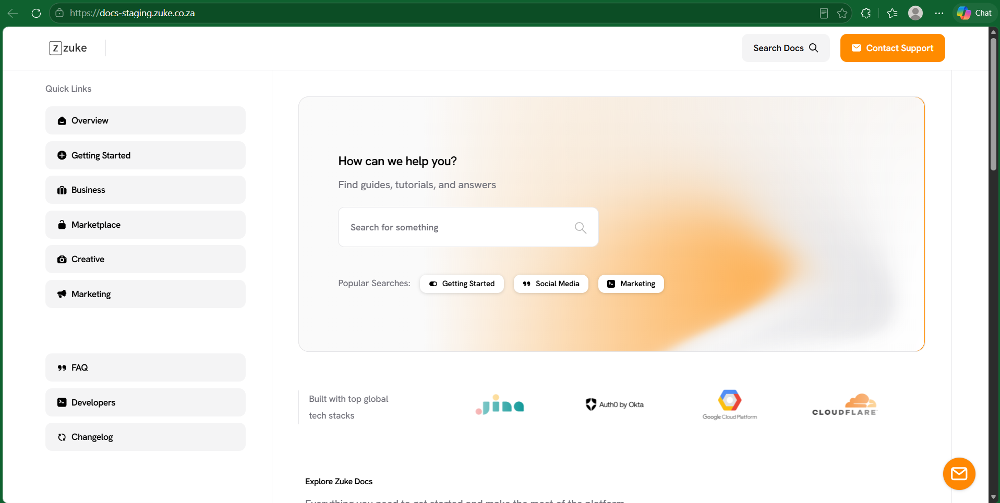

# Industry Placement GitHub Portfolio

## Vic3e Media and Technology Solutions — Zuke Documentation Site & Lulem

A portfolio of project evidence and reflections for **Project Presentation 3 (PRP372S)**.

## Student Details

- **Name and Surname:** Amanda Msutu
- **Student Number:** 222428600
- **Institution:** Cape Peninsula University of Technology
- **Course:** Diploma in ICT Applications Development
- **Module:** Project Presentation 3
- **Module Code:** PRP372S
- **Host Employer:** Vic3e Media and Technology Solutions (Information Technology Department)

## Project Overview

This portfolio documents my Industry Placement, completed between 1 July and 30 November, with a focus on my work at Vic3e from August. The work was organised into user stories, a product backlog and weekly sprints, and tracked in an Agile Logbook.

I worked on two projects in Vic3e's IT department:

- **Zuke Documentation Site** — A WordPress documentation site that provides users with step-by-step guidance for zuke.co.za, starting with the landing page and sign-up journey.
- **Lulem** — A digital-signage application for retail TVs. It displays image and video advertisements, shows Paystack QR codes for payments, and plays YouTube videos between advertising sessions. It runs on a Raspberry Pi, which I configured and protected with a custom 3D-printed fan case.

I also supported Vic3e's media work, including filming and editing a Lulem promotional video and assisting with summit preparation.

## Zuke Documentation Site Landing Page

  

  <em>Zuke documentation site landing page — designed and built with WordPress and Elementor.</em>

## Technology Stack

### Documentation and Content

-  **WordPress** — Hosts and manages the Zuke documentation site.
-  **Elementor** — Used to design and build the landing page and user journey pages.

### Digital Signage and Hardware

-  **Raspberry Pi** — Runs Lulem on retail TVs and was configured as part of the project.
-  **Paystack** — Provides the payment QR codes displayed by Lulem.
-  **YouTube** — Supplies the videos played between Lulem's advertising sessions.

Technology logos sourced from <a href="https://simpleicons.org/">Simple Icons</a> and <a href="https://devicon.dev/">Devicon</a>.

## Project Links

- **Zuke Documentation Site:** [Add link]
- **Product Website:** [zuke.co.za](https://zuke.co.za)
- **Project Board:** [Add link]

## Portfolio Sections

### 1. Agile Team Charter

- [View Evidence](01-agile-team-charter/evidence.md)
- [Reflection](01-agile-team-charter/reflection.md)

### 2. User Stories and Tasks

- [View Evidence](02-user-stories-and-tasks/evidence.md)
- [Reflection](02-user-stories-and-tasks/reflection.md)

### 3. Product Backlog

- [View Evidence](03-product-backlog/evidence.md)
- [Reflection](03-product-backlog/reflection.md)

### 4. Sprint Backlog

- [View Evidence](04-sprint-backlog/evidence.md)
- [Reflection](04-sprint-backlog/reflection.md)

### 5. Agile Logbook

- [View Evidence](05-agile-logbook/evidence.md)
- [Reflection](05-agile-logbook/reflection.md)
